# TP 4 : Sockets en mode non-connecte UDP

## Informations générales

- Nom : Rihab Tarchi
- Classe : LSI3-2-2
- Matière : Développement d'applications réparties

## 1. Objectifs

L'objectif de ce TP est de développer une application
de chat Client/Serveur en utilisant le protocole UDP.

Cette application permet :
- L'envoi de messages entre client et serveur.
- La réception de datagrammes UDP.
- La communication entre plusieurs clients.
- La diffusion des messages via le serveur.

## 4. Structure du Projet :

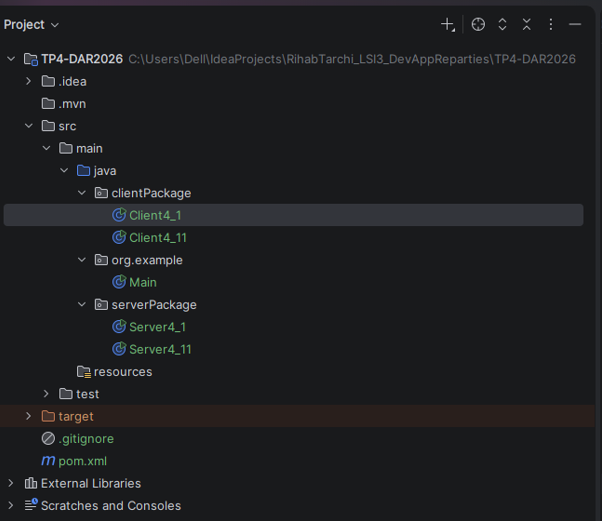

### Étape 2 : Chat unidirectionnel

Le serveur écoute sur le port 1234.
Le client envoie des messages sous forme de datagrammes UDP.
Le serveur affiche les messages reçus avec l'adresse IP
et le port de l'expéditeur.

### Code du Serveur et Client :

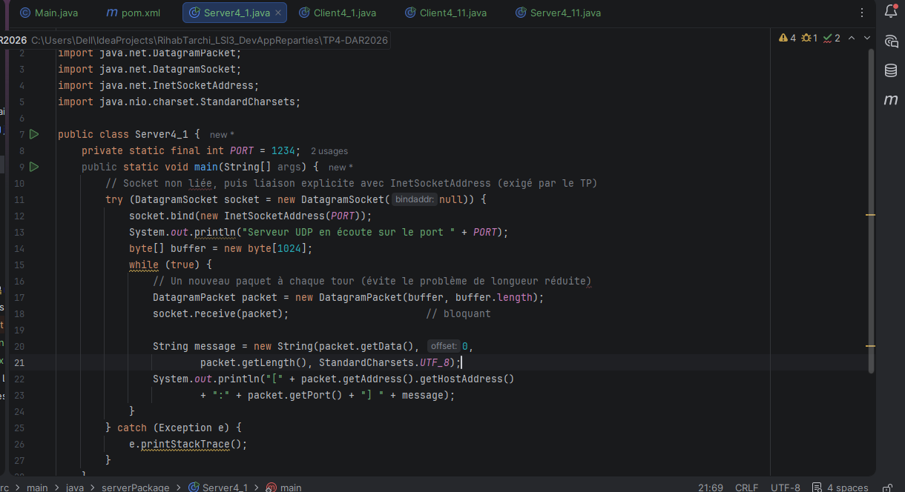

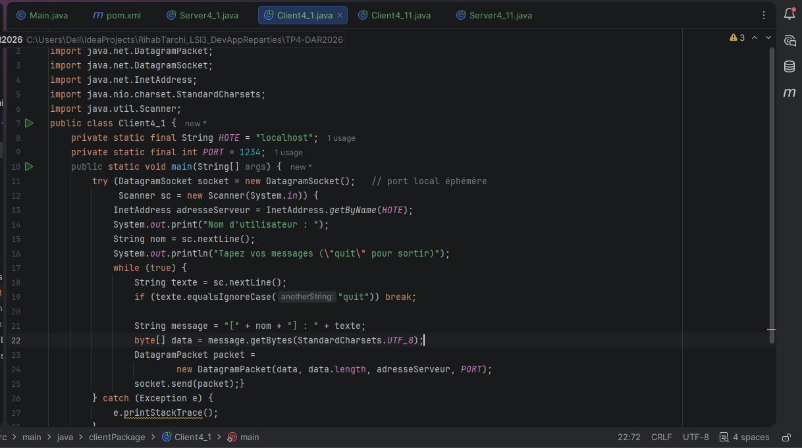

### Execution :
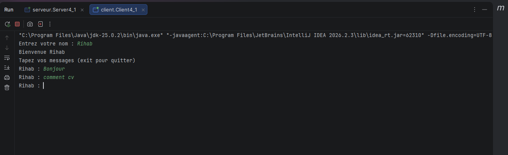
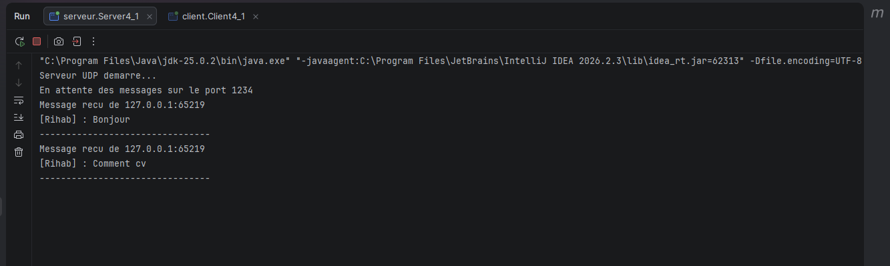
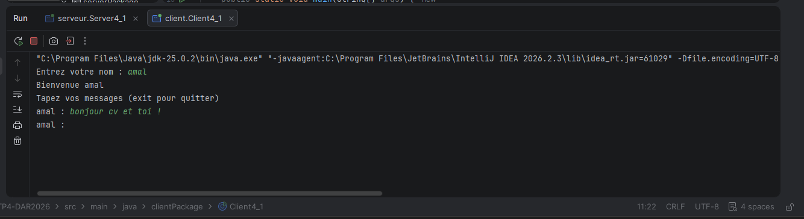
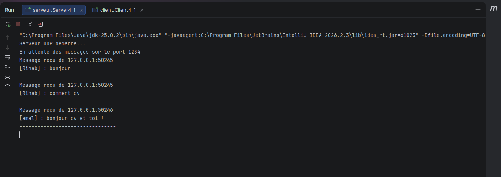

### Étape 3 : Chat bidirectionnel

Le serveur conserve les adresses des clients.
Lorsqu'un message est reçu, il le diffuse aux autres clients.

L'utilisation des Threads permet d'effectuer simultanément
l'envoi et la réception des messages.

### Code du Serveur et Client :

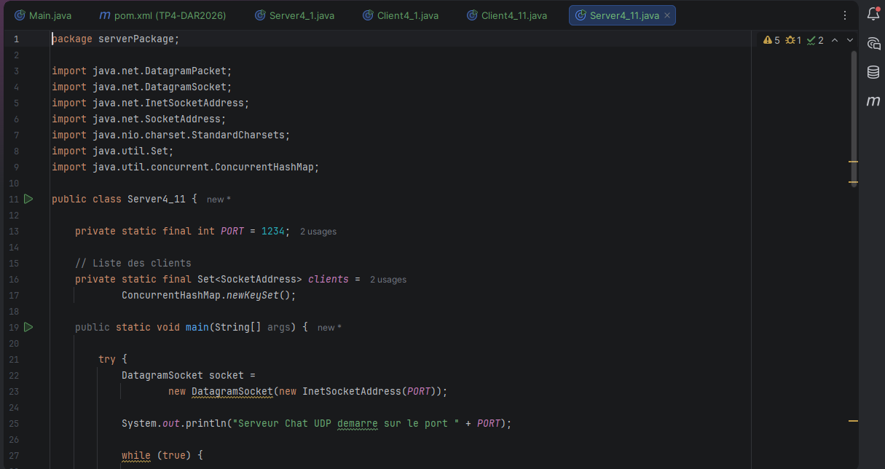
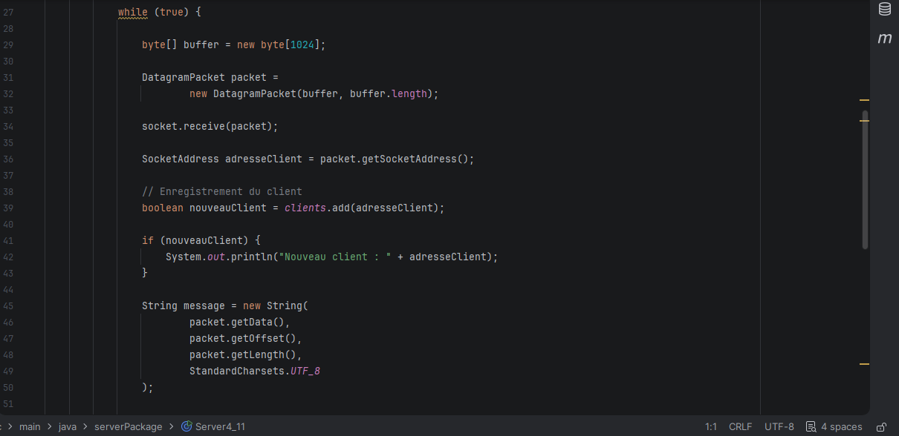
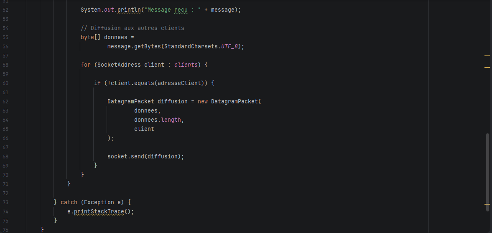

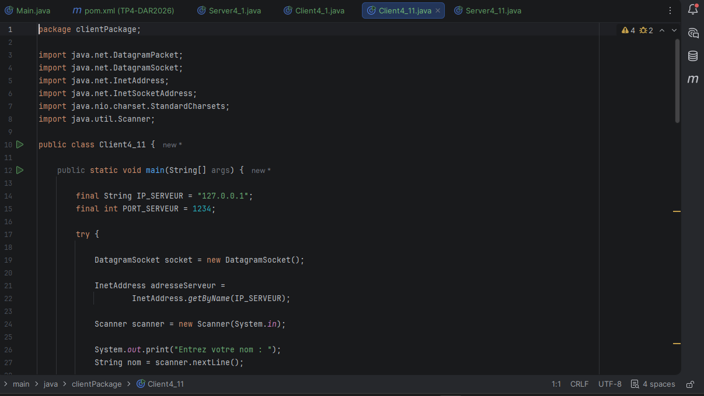

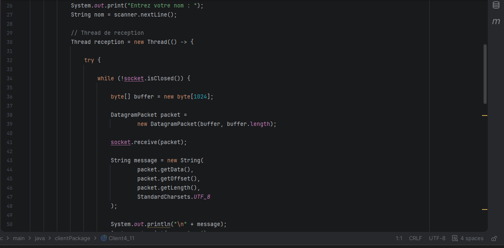
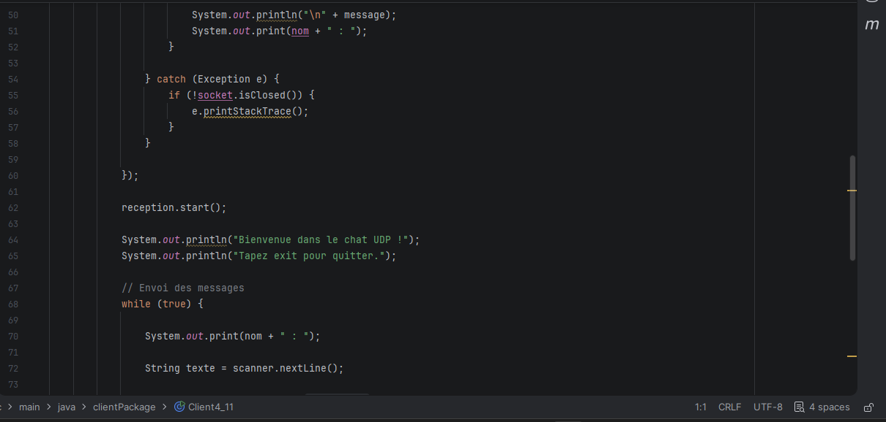
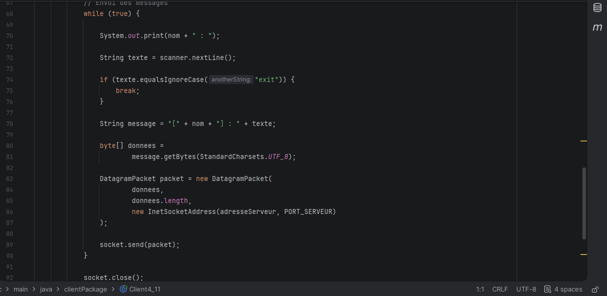
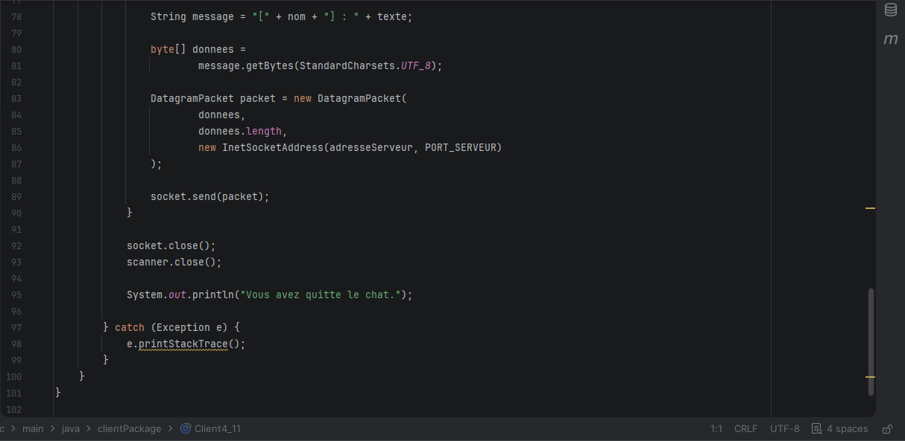

### Execution :
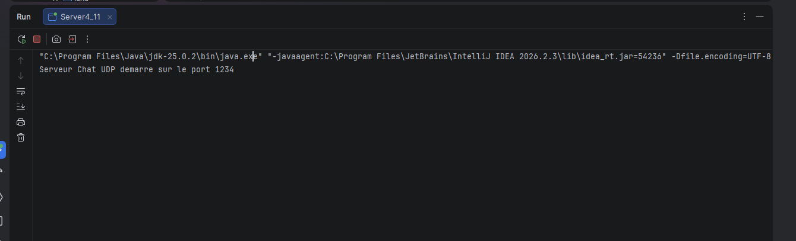
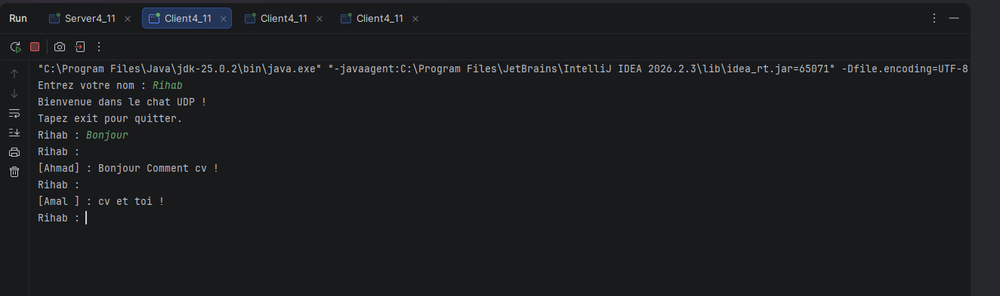
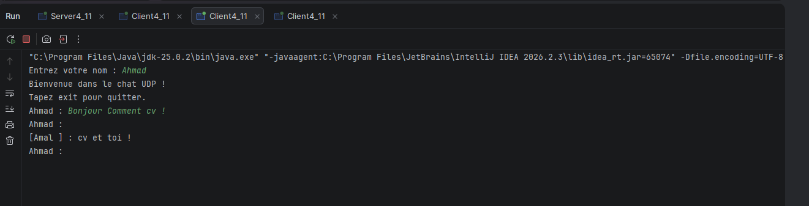
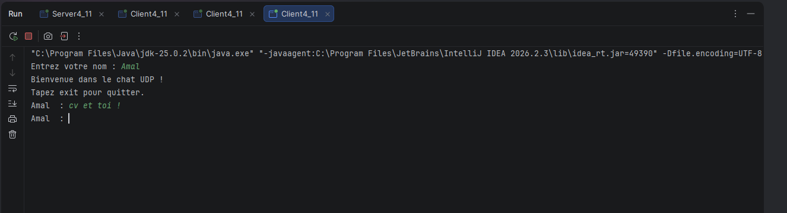

## 5. Conclusion

Ce TP m'a permis de comprendre le fonctionnement
des sockets UDP en Java.

J'ai appris à utiliser DatagramSocket et DatagramPacket
pour envoyer et recevoir des datagrammes.

J'ai également développé une application de chat
Client/Serveur permettant la communication entre
plusieurs clients grâce à la diffusion des messages
par le serveur et à l'utilisation des Threads.
